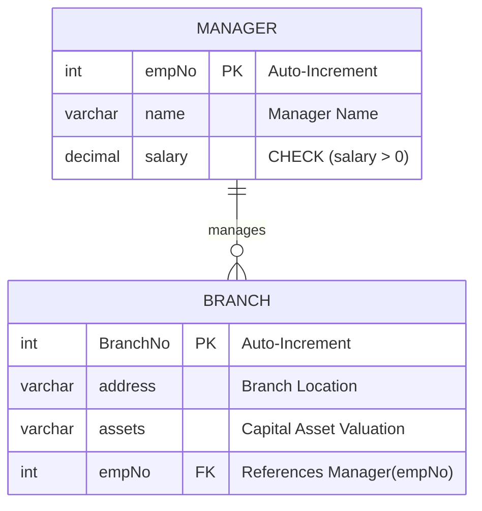

# 🏛️ Relational Database Schema Design: Enterprise Branch & Manager Management (MySQL DDL)

[](https://www.mysql.com/)
[]()
[]()
[](https://islamyasser424-design.github.io/portfolio-/)

> **A foundational Data Engineering & Relational Schema implementation designing normalized enterprise operational structures in MySQL: defining primary/foreign key hierarchies, enforcing positive compensation check constraints (`CHECK salary > 0`), and establishing referential integrity between branch assets and leadership.**

---

## 📌 Table of Contents
- [✨ Project Overview](#-project-overview)
- [📐 Entity Relationship Diagram (ERD)](#-entity-relationship-diagram-erd)
- [🏗️ Schema Architecture & DDL Specification](#️-schema-architecture--ddl-specification)
  - [1. Manager Table (`Manager`)](#1-manager-table-manager)
  - [2. Branch Table (`Branch`)](#2-branch-table-branch)
- [🧪 Verification Seed Data & Test Cases](#-verification-seed-data--test-cases)
- [📊 Analytical Validation Queries](#-analytical-validation-queries)
- [🛡️ Constraint Enforcement & Security](#️-constraint-enforcement--security)
- [🚀 How to Execute Locally](#-how-to-execute-locally)
- [👤 Author & Connect](#-author--connect)

---

## ✨ Project Overview

In production database administration and dimensional engineering, sound physical data modeling prevents downstream data corruption, unlinked orphan records, and invalid accounting entries:
1. **Referential Integrity Enforcement:** Establishing a formal $1:\text{N}$ (One-to-Many) relationship linking managerial personnel (`Manager`) to physical commercial installations (`Branch`).
2. **Business Rule Hardening at Schema Level:** Embedding database-level validation (`CHECK (salary > 0)`) to reject invalid payroll allocations before data enters reporting pipelines.
3. **Primary Key Auto-Sequencing:** Utilizing surrogate auto-increment identifiers to decouple operational entities from business-sensitive natural keys.

---

## 📐 Entity Relationship Diagram (ERD)



---

## 🏗️ Schema Architecture & DDL Specification

```sql
-- Step 1: Initialize Database Environment
DROP DATABASE IF EXISTS manages;
CREATE DATABASE manages 
    CHARACTER SET utf8mb4 
    COLLATE utf8mb4_unicode_ci;

USE manages;

-- -----------------------------------------------------------------------------
-- 1. Manager Table
-- -----------------------------------------------------------------------------
CREATE TABLE Manager (
    empNo INT PRIMARY KEY AUTO_INCREMENT,
    name VARCHAR(100) NOT NULL,
    salary DECIMAL(10, 2) NOT NULL,
    CONSTRAINT chk_manager_salary CHECK (salary > 0)
);

-- -----------------------------------------------------------------------------
-- 2. Branch Table
-- -----------------------------------------------------------------------------
CREATE TABLE Branch (
    BranchNo INT PRIMARY KEY AUTO_INCREMENT,
    address VARCHAR(100) NOT NULL,
    assets VARCHAR(100) NOT NULL,
    empNo INT,
    CONSTRAINT fk_branch_manager FOREIGN KEY (empNo) 
        REFERENCES Manager(empNo)
        ON UPDATE CASCADE
        ON DELETE SET NULL
);
```

---

## 🧪 Verification Seed Data & Test Cases

```sql
-- Insert verified manager records
INSERT INTO Manager (name, salary) VALUES
    ('Ahmed El-Sayed', 28500.00),
    ('Mona El-Shamy', 34000.00),
    ('Khaled Mahmoud', 31200.00),
    ('Nourhan Tarek', 29800.00);

-- Insert operational branch records mapped to managers
INSERT INTO Branch (address, assets, empNo) VALUES
    ('15 Tahrir Square, Downtown, Cairo', '$1,250,000 Capital Assets', 1),
    ('42 El-Horreya Avenue, Alexandria', '$850,000 Logistics Hub', 2),
    ('90th Street North, New Cairo', '$2,100,000 Flagship Retail', 1),
    ('Giza Plateau Road, Giza', '$650,000 Warehouse Annex', 3),
    ('Corniche El-Nil, Maadi, Cairo', '$920,000 Corporate Center', NULL);
```

---

## 📊 Analytical Validation Queries

### Query 1: Branch Operations Audit with Assigned Leadership
```sql
SELECT 
    b.BranchNo,
    b.address AS branch_address,
    b.assets AS branch_assets,
    COALESCE(m.name, 'Unassigned / Vacant') AS manager_name,
    COALESCE(CONCAT('$', FORMAT(m.salary, 2)), 'N/A') AS manager_salary
FROM Branch b
LEFT JOIN Manager m ON b.empNo = m.empNo
ORDER BY b.BranchNo ASC;
```

#### Expected Output:
| BranchNo | branch_address | branch_assets | manager_name | manager_salary |
|:---:|:---|:---|:---|:---|
| **1** | 15 Tahrir Square, Downtown, Cairo | $1,250,000 Capital Assets | Ahmed El-Sayed | $28,500.00 |
| **2** | 42 El-Horreya Avenue, Alexandria | $850,000 Logistics Hub | Mona El-Shamy | $34,000.00 |
| **3** | 90th Street North, New Cairo | $2,100,000 Flagship Retail | Ahmed El-Sayed | $28,500.00 |
| **4** | Giza Plateau Road, Giza | $650,000 Warehouse Annex | Khaled Mahmoud | $31,200.00 |
| **5** | Corniche El-Nil, Maadi, Cairo | $920,000 Corporate Center | Unassigned / Vacant | N/A |

---

## 🛡️ Constraint Enforcement & Security

| Constraint | Type | Enforcement Behavior |
|---|---|---|
| `PRIMARY KEY` | Entity Integrity | Enforces uniqueness and automatically creates a clustered B-Tree index on `empNo` and `BranchNo`. |
| `CHECK (salary > 0)` | Domain Integrity | Blocks negative or zero compensation entries at database engine level (`Error 3819`). |
| `FOREIGN KEY (empNo)` | Referential Integrity | Restricts `Branch.empNo` to valid `Manager.empNo` keys, preventing orphaned branches (`Error 1452`). |
| `ON DELETE SET NULL` | Cascade Rule | If a manager departs, their branches remain safely recorded with vacant assignment rather than being deleted. |

---

## 🚀 How to Execute Locally

1. **Clone the repository:**
   ```bash
   git clone https://github.com/islamyasser424-design/SQL-Task-1.git
   cd SQL-Task-1
   ```
2. **Execute via MySQL CLI or Workbench:**
   ```bash
   mysql -u root -p < SQL_Task_01_Manager_Branch_Schema.sql
   ```

---

## 👤 Author & Connect

* **Author:** Islam Yasser — *Data Analyst & Business Intelligence Specialist*
* **Portfolio:** [islamyasser424-design.github.io/portfolio-/](https://islamyasser424-design.github.io/portfolio-/)
* **LinkedIn:** [linkedin.com/in/islam-yasser-55048b378](https://www.linkedin.com/in/islam-yasser-55048b378/)
* **GitHub:** [github.com/islamyasser424-design](https://github.com/islamyasser424-design)